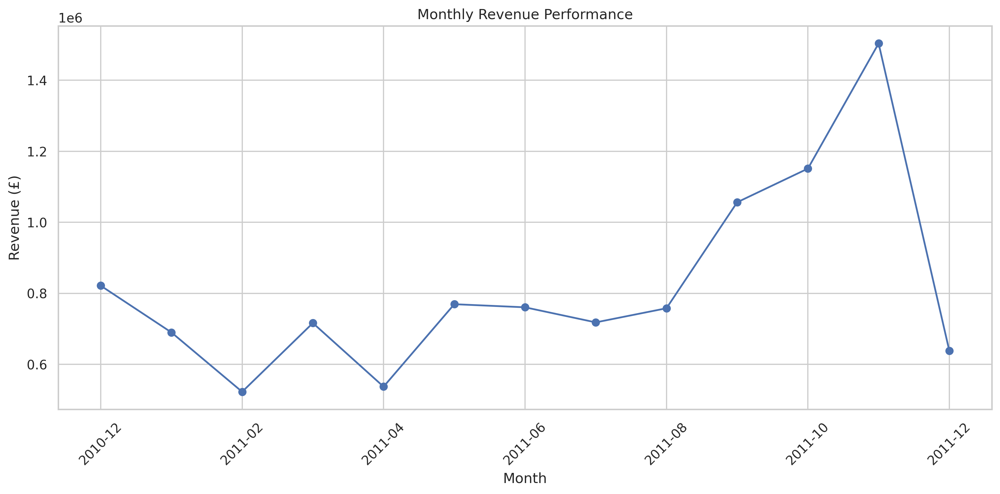
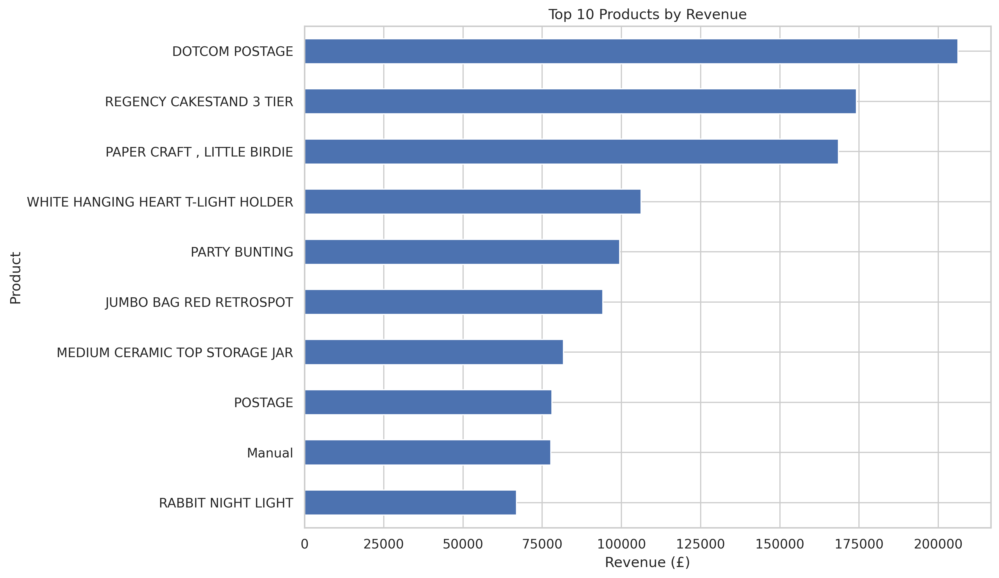
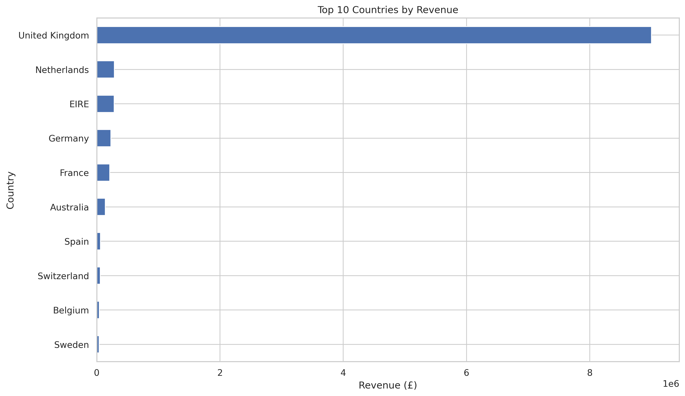
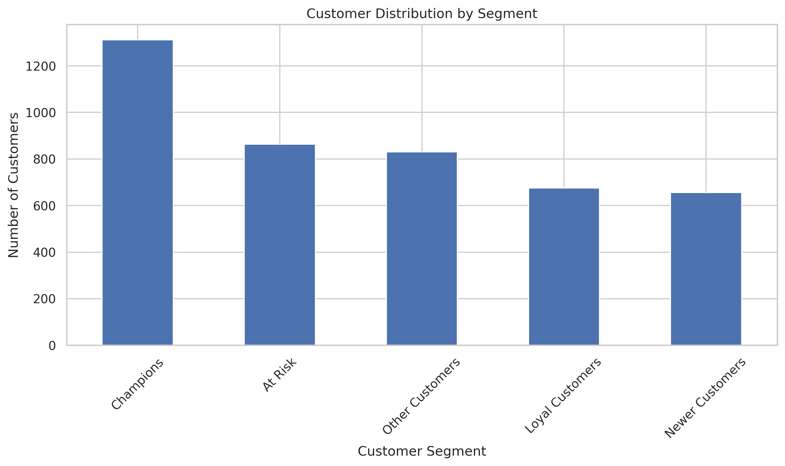
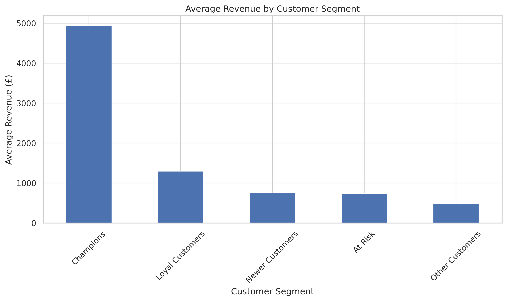
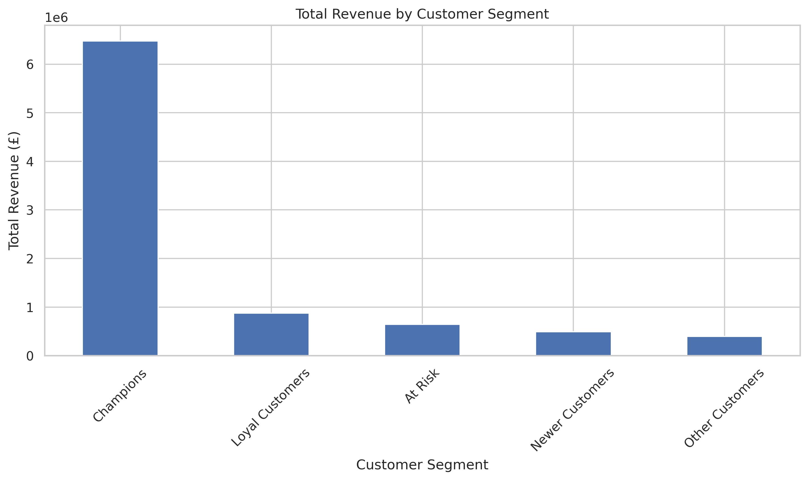

# Customer & Retail Sales Analysis

## 1. Project Overview

This project explores retail transaction data to identify sales trends, understand customer purchasing behaviour and evaluate business performance.

Using Python and data analytics techniques, the project transforms raw retail transaction records into meaningful business insights. The analysis focuses on sales performance, product revenue, geographical performance and customer segmentation using Recency, Frequency and Monetary (RFM) analysis.

## 2. Project Objectives

- Clean and prepare retail transaction data.
- Analyse overall sales and revenue performance.
- Identify monthly revenue trends.
- Evaluate top-performing products.
- Analyse revenue distribution across countries.
- Understand customer purchasing behaviour.
- Perform customer segmentation using RFM analysis.
- Develop data-driven business recommendations.

## 3. Dataset

**Source:** [UCI Machine Learning Repository – Online Retail Dataset](https://archive.ics.uci.edu/dataset/352/online+retail)

The dataset contains 541,909 transaction records from a UK-based online retail business, covering transactions between December 2010 and December 2011.

The dataset includes invoice numbers, stock codes, product descriptions, quantities, invoice dates, unit prices, customer IDs and countries.

After data cleaning, 525,460 records remained for analysis.

## 4. Technologies and Tools

- Python
- Pandas
- NumPy
- Matplotlib
- Seaborn
- Jupyter Notebook

## 5. Data Cleaning and Preparation

The data preparation process included:

- Identifying and removing duplicate records.
- Removing cancelled transactions.
- Filtering invalid quantities and unit prices.
- Handling missing product descriptions.
- Creating a Revenue column using quantity multiplied by unit price.
- Preparing customer records for RFM analysis.

## 6. Key Findings

### Overall Sales Performance

| Metric | Result |
|---|---:|
| Total Revenue | £10,642,110.80 |
| Total Orders | 20,134 |
| Units Sold | 5,612,470 |
| Average Order Value | £528.56 |
| Identified Customers | 4,339 |

### Monthly Revenue Performance

November recorded the highest monthly revenue, with sales increasing significantly between September and November.

### Product Performance

The Regency Cake Stand 3 Tier and Paper Craft Little Birdie were among the leading products by revenue. The analysis also identified postage and manual transaction entries among high-revenue descriptions.

### Geographical Performance

The United Kingdom generated approximately 84.59% of total revenue, demonstrating the business's strong dependence on its domestic market.

### Customer Segmentation

RFM analysis identified five customer segments:

| Customer Segment | Customers | Revenue Contribution |
|---|---:|---:|
| Champions | 1,312 | 72.87% |
| Loyal Customers | 676 | 9.85% |
| At Risk | 864 | 7.24% |
| Newer Customers | 656 | 5.56% |
| Other Customers | 831 | 4.48% |

Champions represented the most valuable customer segment, contributing the majority of customer revenue.

## 7. Data Visualisations

### Monthly Revenue Performance



### Top Products by Revenue



### Revenue by Country



### Customer Segment Distribution



### Average Revenue by Customer Segment



### Total Revenue by Customer Segment



## 8. Business Recommendations

- Introduce loyalty programmes and personalised offers to retain Champions.
- Use targeted promotions to re-engage At Risk customers.
- Encourage repeat purchases among newer customers.
- Explore opportunities to expand international sales.
- Prepare inventory and marketing campaigns ahead of seasonal sales peaks.
- Monitor product performance to improve inventory planning.

## 9. Conclusion

This project shows how data analytics can help businesses understand customer behaviour, identify sales opportunities and make informed decisions.

By combining exploratory data analysis, sales performance evaluation and RFM customer segmentation, the project provides actionable insights into retail performance and customer value.

## 10. Project Structure

```text
customer-data-analysis/
│
├── data/
│   └── Online Retail.xlsx
│
├── images/
│   ├── monthly_revenue.png
│   ├── top_products.png
│   ├── country_revenue.png
│   ├── customer_segments.png
│   ├── average_revenue_by_segment.png
│   └── total_revenue_by_segment.png
│
├── notebooks/
│   └── customer_analysis.ipynb
│
├── README.md
└── requirements.txt
```

## 11. Author

Thembinkosi Leago Mosupi,
BSc IT (Data Science) Student

**Skills demonstrated:** Python, Data Cleaning, Exploratory Data Analysis, Data Visualisation, Customer Segmentation, RFM Analysis and Business Analytics.
